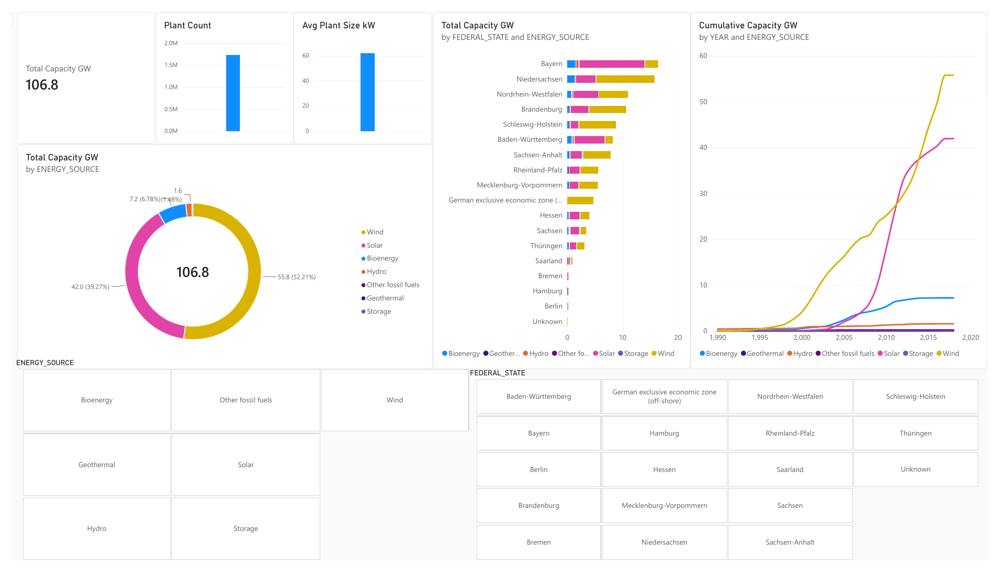
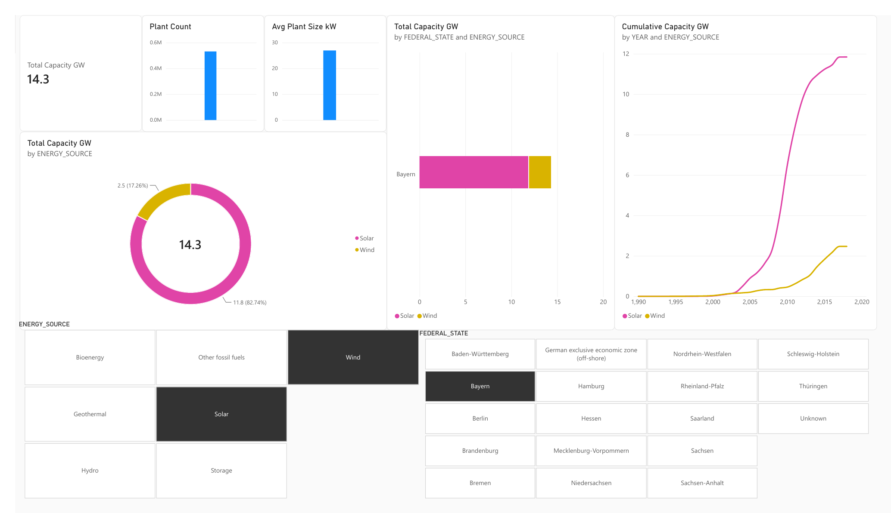
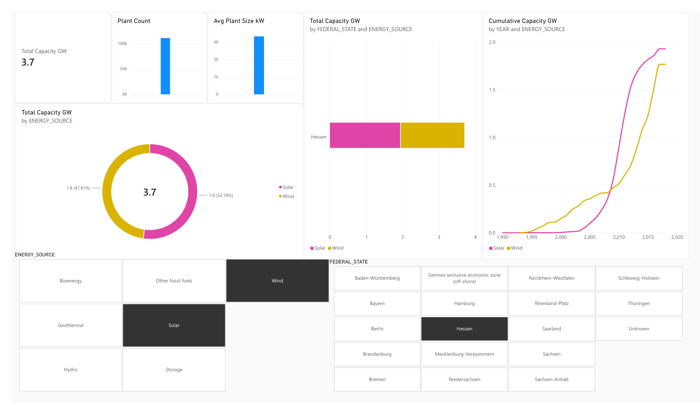

# Germany Renewables Pipeline: S3 → Snowflake → Power BI

An end-to-end **ELT** pipeline that loads **1.7 million German renewable power plants** (EEG register) from Amazon S3 into Snowflake, cleans and models them with SQL into a star schema, and visualises the Energiewende in Power BI.



## Architecture

```
Amazon S3 (raw CSV, 342 MB)
   │  IAM user, read-only policy on s3://project2-snowflake/energy/*
   ▼
Snowflake external stage ──COPY INTO──► RAW  (all columns as text, + audit columns)
                                          │  SQL transforms
                                          ▼
                                        CLEAN (typed, fixed, privacy-reduced)
                                          │                 └──► AUDIT (8 data-quality checks)
                                          ▼
                                        MART (star schema: 1 fact + 3 dimensions)
                                          │  BI_READER role (read-only, MART only)
                                          ▼
                                        Power BI (Import mode, DAX measures)
```

## Tech stack
Amazon S3 · AWS IAM · Snowflake (stages, COPY INTO, resource monitors, RBAC) · SQL · Power BI · DAX

## Dataset
[Open Power System Data: Renewable power plants](https://data.open-power-system-data.org/renewable_power_plants/) (`renewable_power_plants_DE.csv`, data up to 2020, CC BY 4.0). 27 columns: energy source, technology, capacity, commissioning date, federal state, municipality, postcode, coordinates, and more.
The CSV is not included in this repo (342 MB). Download it from the link above.

## ETL vs ELT (comparison with my previous project)

| | Project 1: AWS serverless | **Project 2: this repo** |
|---|---|---|
| Pattern | ETL | **ELT** |
| Transform | Python (Lambda) before storage | **SQL inside Snowflake** after loading |
| Raw data kept | No | **Yes** (RAW layer, can re-transform anytime) |
| Output | Parquet files queried by Athena | Warehouse tables consumed by Power BI |

## Layers (medallion style)

| Layer | Table(s) | What happens |
|---|---|---|
| RAW (bronze) | `RAW.renewable_plants` | Load all 27 columns as `STRING` so the load can't fail; add `source_file` and `loaded_at` |
| CLEAN (silver) | `CLEAN.renewable_plants` | `TRY_TO_DATE` / `TRY_TO_DOUBLE`, trim, empty → NULL, derived `commissioning_year` and `is_active`, fixed bad dates, dropped street addresses (privacy) |
| AUDIT | `AUDIT.dq_results` | 8 automated quality checks |
| MART (gold) | `fact_plants`, `dim_energy_source`, `dim_location`, `dim_date` | Star schema for Power BI |

## Data quality findings

| Check | Failed rows | Decision |
|---|---|---|
| Missing energy source, capacity > 1 GW, coords outside Germany, decommissioned before commissioned | 0 | ✅ |
| Missing federal state | 430 (0.03 %) | Kept as "Unknown": small plants (~0.03 GW total), mostly in SW Germany |
| Missing coordinates | 1,868 (0.1 %) | Kept; they don't appear on maps |
| Possible duplicates | 39,134 (2.3 %) | **Kept.** Location data is postcode-level, so identical rooftop PV systems in one postcode are real, separate plants |
| Dates out of range | 17 → **4** | `1899-12-30/31` are spreadsheet placeholder dates (solar in 1899 is impossible) and `2107` is a typo → set to NULL. 4 genuine 1890s hydro plants kept |

**Reconciliation:** RAW 1,727,278 → CLEAN 1,727,277 (1 row without capacity) → fact table 1,727,277. Total capacity **106.8 GW** matches between Snowflake and Power BI.

## Key results (installed capacity, data to 2020)
- **Wind 55.8 GW (52 %)**, **Solar 42.0 GW (39 %)**, Bioenergy 7.2 GW, Hydro 1.6 GW
- Average plant size **~62 kW**: the Energiewende is driven by millions of small rooftop PV systems
- Solar capacity takes off around 2009–2012 and wind grows steadily from 2000 (EEG law)
- **Bayern** is solar-led; **Niedersachsen, Brandenburg and Schleswig-Holstein** are wind-led; offshore wind sits in the German exclusive economic zone

| Bayern: solar vs wind | Hessen: solar vs wind |
|---|---|
|  |  |

## Design decisions
- **Least privilege:** the IAM policy is read-only on one S3 prefix. Power BI connects as `powerbi_user` with role `BI_READER`, which can only read `MART`.
- **Star schema instead of one flat table:** less redundancy, faster filtering, and a proper date table for time intelligence (cumulative capacity).
- **Import mode, not DirectQuery:** static dataset, so one load and no warehouse credits per click.
- **Cost controls:** X-Small warehouse, 60 s auto-suspend, and a resource monitor that suspends at 10 credits per month. The whole project used roughly $1 of Snowflake trial credit.

## Lessons learned
- **Storage integration vs access keys:** I first set up an IAM role + storage integration (the recommended production approach) and hit persistent `sts:AssumeRole` errors. To finish, I switched to a scoped IAM user with an access key, which I deleted after the load. For production, I'd use the storage integration so there are no long-lived keys.
- **Secondary roles:** new Snowflake users have `DEFAULT_SECONDARY_ROLES = ('ALL')`, so a "read-only" role still inherited admin rights during testing. I disabled them to make least privilege actually work.
- **Always investigate before deleting:** the "duplicates" and "1899" dates looked like the same kind of problem but needed opposite decisions.

## Repo contents
- `README.md`: this file
- `QUERIES.md`: all Snowflake SQL (in run order) and DAX measures
- `images/`: dashboard screenshots
- `energy_deutschland.pbix`: Power BI report (opens offline; data is imported)

## Possible next steps
Snowpipe auto-ingest on new S3 files · Streams + Tasks or Dynamic Tables to refresh CLEAN/MART automatically · dbt for transformations and tests · rebuild the pipeline in PySpark on Databricks for comparison
